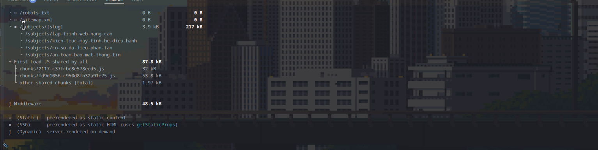
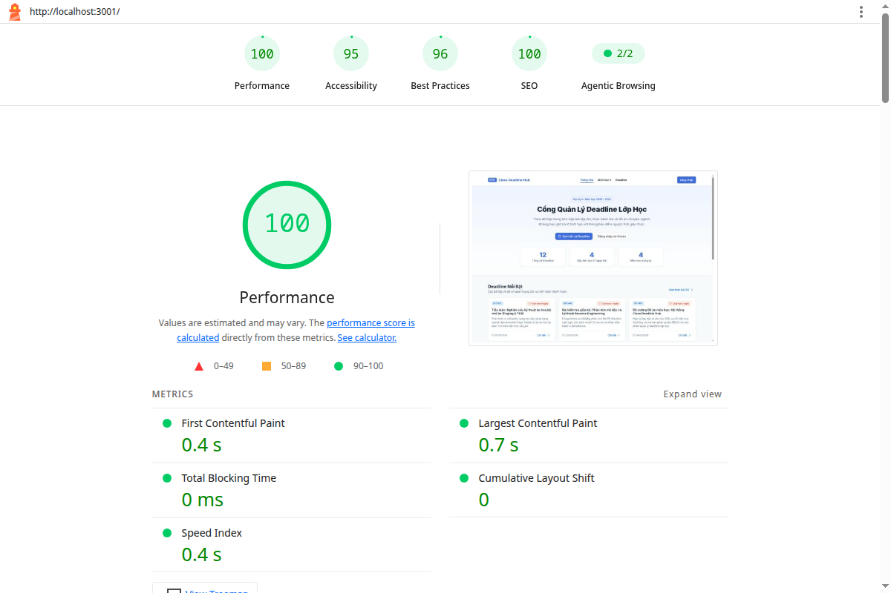
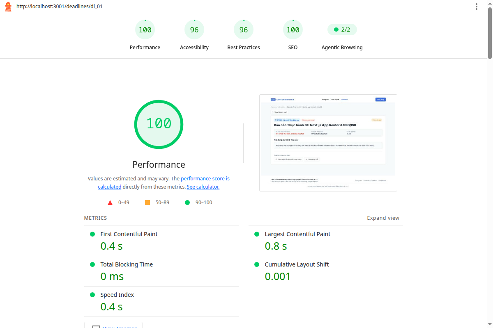
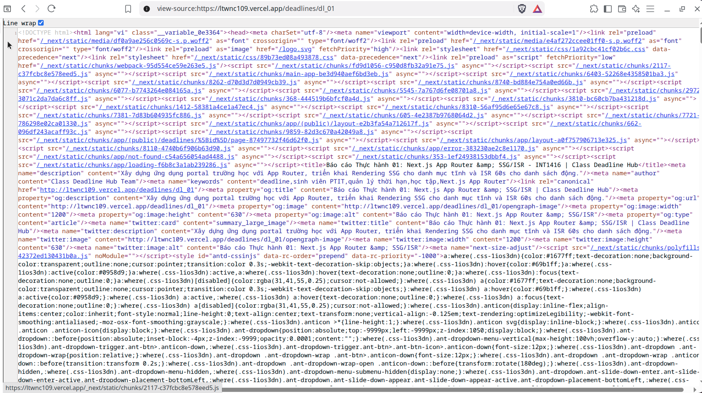

# Class Deadline Hub - Báo Cáo Bài Tập Học Phần

> 🌐 **Domain Deploy (Vercel Production)**: **[https://ltwnc109.vercel.app](https://ltwnc109.vercel.app)**  
> 🔗 **Public URL**: `https://ltwnc109.vercel.app`

---

## 1. Cách chạy ứng dụng

### 1.1. Cài đặt và chạy trên máy (Local)
```bash
# 1. Cài đặt dependencies
npm install

# 2. Chạy môi trường phát triển (Development)
npm run dev
# Truy cập tại: http://localhost:3000

# 3. Build và chạy Production
npm run build
npm start

# 4. Chạy kiểm thử tự động (Jest)
npm test
```

### 1.2. Tài khoản thử nghiệm (Demo Accounts)
| Vai trò | Email / Phương thức | Mật khẩu | Quyền hạn |
|---|---|---|---|
| **Lớp trưởng (Admin)** | `admin@ptit.edu.vn` | `admin123` | Toàn quyền quản trị, thêm mới và xóa deadline tại `/admin` |
| **Sinh viên (User)** | `sv@ptit.edu.vn` | `sv123456` | Xem deadline, vào `/dashboard`, đánh dấu hoàn thành bài tập cá nhân |
| **GitHub OAuth** | Đăng nhập tài khoản GitHub | *Ủy quyền* | Tự động gán quyền Sinh viên để theo dõi tiến độ cá nhân |

---

## 2. Ảnh kết quả `npm run build` và Lý do chọn chiến lược cho từng route

### 2.1. Ảnh kết quả `npm run build` thực tế





### 2.2. Lý do chọn chiến lược rendering cho từng route

| Route | Chiến lược | Cấu hình kỹ thuật | Lý do lựa chọn |
|---|---|---|---|
| `/` | **SSG** (Static Site Generation) | `export const dynamic = 'force-static'` | Trang chủ là landing page công khai, dữ liệu giới thiệu và thống kê được tính trước tại build time, giúp tải trang ngay tức thì và tối ưu SEO tuyệt đối. |
| `/subjects/[slug]` | **SSG** | `generateStaticParams()` prerender 4 môn | Danh sách 4 môn học PTIT là dữ liệu cố định. Việc prerender sẵn 4 trang tĩnh giúp phản hồi không độ trễ. Slug không tồn tại tự động chuyển sang trang 404. |
| `/deadlines` | **ISR 60s** (Incremental Static Regeneration) | `export const revalidate = 60` | Danh sách bài tập công khai cần được cache tĩnh để phục vụ nhanh, đồng thời tự động tái tạo ngầm sau mỗi 60 giây khi có dữ liệu mới. |
| `/deadlines/[id]` | **ISR + On-Demand** | `generateStaticParams()` (12 bài) + `revalidate = 60` + `revalidatePath` | Prerender sẵn 12 deadline chi tiết. Cho phép tự làm mới định kỳ (time-based) và xóa cache tức thì (On-demand) ngay khi Admin thêm hoặc xóa deadline. |
| `/dashboard` | **SSR** (Server-Side Rendering) | `export const dynamic = 'force-dynamic'` | Dữ liệu tiến độ học tập phụ thuộc vào phiên đăng nhập (`Session`) của từng sinh viên. Phải render động trên mỗi request, không được cache công khai. |
| `/admin` | **SSR** | `export const dynamic = 'force-dynamic'` | Trang quản trị nhạy cảm, yêu cầu xác thực danh tính và kiểm tra quyền `role === 'admin'` trực tiếp từ máy chủ trên từng lượt truy cập. |

---

## 3. Điểm đo lường Lighthouse (Production)

Đo thực tế trên môi trường Production bằng **Lighthouse 13.5.0**:

| Trang đo lường | Performance | Accessibility | Best Practices | SEO |
|---|:---:|:---:|:---:|:---:|
| **Trang chủ (`/`)** | **100** | **95** | **96** | **100** |
| **Chi tiết bài tập (`/deadlines/dl_01`)** | **100** | **96** | **96** | **100** |

### 3.1. Ảnh báo cáo Lighthouse Trang chủ (`/`)


### 3.2. Ảnh báo cáo Lighthouse Trang chi tiết bài tập (`/deadlines/dl_01`)


---

## 4. Ảnh View-Source của `/deadlines/1` (`/deadlines/dl_01`)

HTML trả về từ máy chủ đã được prerender sẵn đầy đủ nội dung, thẻ meta Open Graph và dữ liệu có cấu trúc JSON-LD BreadcrumbList:



```html
<!-- Trích xuất từ mã nguồn HTML thực tế của trang /deadlines/dl_01 -->
<title>Báo cáo Thực hành 01: Next.js App Router &amp; SSG/ISR - INT1416 | Class Deadline Hub</title>
<meta name="description" content="Xây dựng ứng dụng portal trường học với App Router, triển khai Rendering SSG cho danh mục tĩnh và ISR 60s cho danh sách động."/>
<link rel="canonical" href="http://localhost:3000/deadlines/dl_01"/>
<meta property="og:title" content="Báo cáo Thực hành 01: Next.js App Router &amp; SSG/ISR | Class Deadline Hub"/>
<meta property="og:image" content="http://localhost:3000/deadlines/dl_01/opengraph-image"/>

<!-- Dữ liệu có cấu trúc JSON-LD chuẩn Schema.org cho SEO -->
<script type="application/ld+json">
{
  "@context": "https://schema.org",
  "@type": "BreadcrumbList",
  "itemListElement": [
    { "@type": "ListItem", "position": 1, "name": "Trang chủ", "item": "http://localhost:3000" },
    { "@type": "ListItem", "position": 2, "name": "Danh sách Deadline", "item": "http://localhost:3000/deadlines" },
    { "@type": "ListItem", "position": 3, "name": "Báo cáo Thực hành 01: Next.js App Router & SSG/ISR", "item": "http://localhost:3000/deadlines/dl_01" }
  ]
}
</script>
```

---

## 5. Trả lời 2 câu hỏi lý thuyết

### (1) Vì sao `/deadlines/[id]` dùng ISR?
Trang chi tiết deadline có nội dung công khai, tương đối ổn định (tiêu đề bài tập, mô tả, hạn nộp ít khi thay đổi liên tục từng giây).
- **Nếu dùng SSR thuần túy**: Máy chủ sẽ phải tính toán và truy vấn dữ liệu cho từng request, gây lãng phí tài nguyên và làm tăng thời gian phản hồi (TTFB).
- **Nếu dùng SSG thuần túy**: Khi Lớp trưởng cập nhật hoặc thêm deadline mới, toàn bộ ứng dụng sẽ phải build lại từ đầu.

**ISR (Incremental Static Regeneration)** giải quyết triệt để vấn đề này nhờ kết hợp 2 cơ chế:
1. **Prerender & Performance (Time-based)**: Các deadline có sẵn được tạo trước thành file HTML tĩnh thông qua `generateStaticParams()`. Khách truy cập hoặc bot tìm kiếm nhận được phản hồi ngay lập tức (điểm Performance 100). Cấu hình `revalidate = 60` cho phép trang tự động cập nhật lại ngầm sau mỗi 60 giây khi có dữ liệu mới mà không bắt người dùng phải chờ.
2. **Làm mới theo yêu cầu (On-demand Revalidation)**: Trong Server Action, khi Admin thực hiện thêm hoặc xóa deadline, máy chủ gọi `revalidatePath('/deadlines/[id]')` để xóa cache ngay lập tức, đảm bảo dữ liệu mới nhất được hiển thị tức thì mà không cần build lại toàn bộ website.

---

### (2) Nếu chỉ dùng Middleware để bảo vệ `/admin` thì có rủi ro gì?
Chỉ dùng Middleware là **không đủ an toàn** và tạo ra lỗ hổng bảo mật nghiêm trọng vì những lý do sau:
1. **Middleware chỉ là lớp cổng ở mức định tuyến (Routing/Edge Gate)**: Middleware kiểm tra URL pathname khi người dùng điều hướng trên trình duyệt. Tuy nhiên, các **Server Actions** trong Next.js App Router bản chất là các endpoint POST HTTP riêng biệt được mã hóa ID.
2. **Nguy cơ Bypass thao tác nhạy cảm**: Kẻ tấn công hoặc người dùng có tài khoản sinh viên thường (`role: user`) có thể gửi request POST trực tiếp tới Server Action thêm/xóa deadline (thông qua Postman, cURL hoặc fetch script) mà không cần đi qua giao diện `/admin`. Nếu Server Action không tự xác thực session và không gọi hàm `can(session.user.role, 'delete_deadline')`, kẻ tấn công có thể xóa sạch dữ liệu deadline của cả lớp.
3. **Nguyên tắc Defense in Depth (Bảo vệ đa tầng)**: Bảo vệ ở tầng định tuyến (Middleware) chỉ nhằm tối ưu trải nghiệm điều hướng. Mọi thao tác đọc/ghi dữ liệu nhạy cảm **bắt buộc phải kiểm tra quyền (Authorization) tại chính Server Action và Data Repository** ở phía máy chủ.
